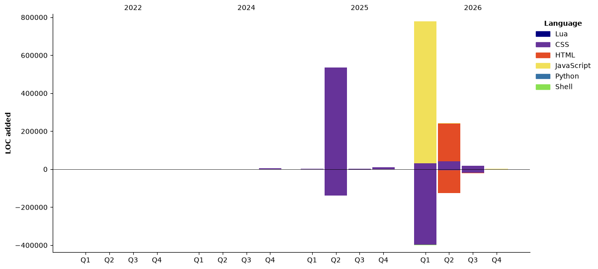

# 👽 Ser4ph4

<samp>
Hello! I'm <a href="https://github.com/Ser4ph4">Ser4ph4</a>, a passionate developer exploring the intersection of infrastructure, development, and automation.
</samp>

I'm deeply interested in:
- **Platform/Infrastructure Engineering** - Building scalable and reliable systems
- **DevOps & SRE** - Automating workflows and improving developer experience
- **Full-Stack Development** - Creating end-to-end solutions with modern technologies

Currently diving deep into cloud-native technologies, container orchestration, and CI/CD pipelines.
## 💭 Dev Quote

[](https://git.io/typing-svg)
---
<div align="center"> 
  


### 📁 Minhas estatísticas de programação
<!--START_SECTION:waka-->


**I'm an Early 🐤** 

```text
🌞 Morning                3181 commits        ████████████░░░░░░░░░░░░░   47.82 % 
🌆 Daytime                1706 commits        ██████░░░░░░░░░░░░░░░░░░░   25.65 % 
🌃 Evening                1332 commits        █████░░░░░░░░░░░░░░░░░░░░   20.02 % 
🌙 Night                  433 commits         ██░░░░░░░░░░░░░░░░░░░░░░░   06.51 % 
```
📅 **I'm Most Productive on Thursday** 

```text
Monday                   833 commits         ███░░░░░░░░░░░░░░░░░░░░░░   12.52 % 
Tuesday                  791 commits         ███░░░░░░░░░░░░░░░░░░░░░░   11.89 % 
Wednesday                988 commits         ████░░░░░░░░░░░░░░░░░░░░░   14.85 % 
Thursday                 1092 commits        ████░░░░░░░░░░░░░░░░░░░░░   16.42 % 
Friday                   1005 commits        ████░░░░░░░░░░░░░░░░░░░░░   15.11 % 
Saturday                 923 commits         ███░░░░░░░░░░░░░░░░░░░░░░   13.88 % 
Sunday                   1020 commits        ████░░░░░░░░░░░░░░░░░░░░░   15.33 % 
```


📊 **This Week I Spent My Time On** 

```text
🕑︎ Time Zone: America/Sao_Paulo

💬 Programming Languages: 
JavaScript               1 hr 51 mins        ██████████████████░░░░░░░   70.26 % 
Other                    21 mins             ███░░░░░░░░░░░░░░░░░░░░░░   13.41 % 
Markdown                 13 mins             ██░░░░░░░░░░░░░░░░░░░░░░░   08.37 % 
JSON                     6 mins              █░░░░░░░░░░░░░░░░░░░░░░░░   03.91 % 
CSS                      3 mins              █░░░░░░░░░░░░░░░░░░░░░░░░   02.28 % 

🔥 Editors: 
VS Code                  2 hrs 23 mins       ██████████████████████░░░   89.95 % 
Sublime Text             15 mins             ███░░░░░░░░░░░░░░░░░░░░░░   10.05 % 

🐱‍💻 Projects: 
luci-app-vnstat-text     2 hrs 8 mins        ████████████████████░░░░░   81.00 % 
luci-theme-proton2025    30 mins             █████░░░░░░░░░░░░░░░░░░░░   18.90 % 
Unknown Project          0 secs              ░░░░░░░░░░░░░░░░░░░░░░░░░   00.09 % 

💻 Operating System: 
Linux                    2 hrs 39 mins       █████████████████████████   100.00 % 
```

🤖 **AI Coding This Week** 

```text
No AI Coding Activity Tracked This Week
```

**I Mostly Code in CSS** 

```text
CSS                      8 repos             █████████░░░░░░░░░░░░░░░░   34.78 % 
HTML                     6 repos             ███████░░░░░░░░░░░░░░░░░░   26.09 % 
JavaScript               4 repos             ████░░░░░░░░░░░░░░░░░░░░░   17.39 % 
Python                   3 repos             ███░░░░░░░░░░░░░░░░░░░░░░   13.04 % 
Shell                    1 repo              █░░░░░░░░░░░░░░░░░░░░░░░░   04.35 % 
```


**Timeline**




 Last Updated on 15/11/2026 23:05:01 UTC
<!--END_SECTION:waka-->
**"Building the future, one commit at a time"** 🚀
</div>
<div align="center"> 
  

</div> 
<div align="center"> 
  
  [](mailto:ouizakz5u@mozmail.com)
  </div> 
